# Our data, and what made the results better

Your data won't look like ours. So this page explains how we built ours, why we built it that way, and which
changes actually moved the numbers. The plant is made up, but the ideas carry over.

## 1. The ontology: your world, written down

<p align="center">
  
</p>

[`data/ontology.yaml`](data/ontology.yaml) is a plain list of the things the jobs are about. Ours is for a made-up
plastics plant:

| What | Ours | Why it's there |
|---|---|---|
| People | 12, each with a role and a nickname or two ("Dave", "Saz") | Owners and speakers |
| Sites | 5: the main site plus places people go ("over at Northfield") | Off-site jobs |
| Machines | 34, in a tree: 4 areas → 7 systems → 23 parts | "The GT2 water valve" is part of Gas Turbine 2, which is part of the power plant |
| Categories | operations, safety, organisation, each with one line saying what it covers | What kind of job it is |
| Priorities | 1 urgent, 2 normal, 3 low, each with one line | How urgent it is |

One machine looks like this:

```yaml
- {id: AIR-C-01, kind: component, name: Air Compressor 1, parent: UTL,
   aliases: [air compressor, compressor one, AC1], heldout_aliases: [the Atlas]}
```

**How it's used:**
- **In every prompt.** The category and priority lines go in word for word, plus a few rules like "if nobody said
  anything about urgency, it's priority 2".
- **For shortlists.** The words people said ("the Atlas") are matched against every name and alias with fuzzy
  matching and embeddings. The model then picks from those few candidates. It never sees the whole list.
- **For scoring.** Because machines are a tree, naming the right parent gets half credit. When the model can't tell
  which part someone meant, it names the parent.
- **For honest testing.** `heldout_aliases` are realistic nicknames that no matcher is ever given. They only show
  up in test transcripts, so we can see how a method copes with words it's never seen. We have 119 known nicknames
  and 51 held-out ones.

**What we learned:**
- **Nicknames are where the misses are.** The best pipeline links a machine 100% of the time when it's called by a
  name in the ontology, and 74% of the time when it's called by a nickname it's never seen. So the cheapest win is
  adding the nicknames people really use. Look in old stand-up notes, tickets or the maintenance system for them.
- **Keep a tree, not a flat list.** It gives a safe answer when unsure (the parent), and it lets the board pipeline
  find cards on the same machine or its parts.
- **Write the rubric down.** Priority and category come from those few lines. Without "if nobody said, it's 2",
  models guess.
- **Work out dates in code, not in the model.** [`dates.py`](src/standup_exp/dates.py) has one rule for
  "Thursday", "next week", "the 3rd" and "half two". The data generator and the pipeline use the same one.

## 2. How we made the data

<p align="center">
  
</p>

We made two sets:

| | Model experiment | Board pipeline |
|---|---|---|
| What | Single stand-ups | 3 teams × 8 working days in a row |
| Size | 140 meetings: 20 written by GPT-5.4, 120 by GPT-6 Astra | 24 stand-ups, 189 things to get right (81 new jobs, 108 updates) |
| Split | Train and test. Only the test meetings use held-out nicknames | All test |
| Cost to write | About $0.15 a meeting with GPT-6 Astra, $0.05 with GPT-5.4 | About $0.13 a stand-up |

**The steps:**
1. **Pick the answer first, in code.** For each meeting: a date, a chair, 7 people, and 5–9 jobs built from
   templates. Each job gets an owner, a machine, maybe a site, a due phrase ("by Thursday") and an urgency cue. Each
   person and machine is called by its name or a nickname. We also add things that must **not** be picked up:
   chit-chat, work finished yesterday, passing remarks, blockers and cancelled work. It's all seeded, so you get the
   same data every time.
2. **For the board, play out the days.** Day 1 starts with an empty board. On each day after, every open card gets
   a fate: done, progress, blocked, cancelled, handed over, a new due date, or not mentioned at all. Cards that are
   due are more likely to be finished. 2–4 new jobs are added each day, some on a machine that already has a card.
3. **A model writes the meeting** around that plan, in Teams style, with the chit-chat and the nicknames it was
   told to use.
4. **Check it's really there.** For every job, the owner, machine and site words must appear near its lines, and
   the due phrase must work out to the same date. If not, the problems go back to the writer and it tries again.
5. **Tag the hard cases**, so the scores can be split by what makes an update hard. Here's how the board pipeline
   did on each (updates exactly right):

   | Tag | What it means | Updates | Right |
   |---|---|---|---|
   | plain | the owner gives their own update and names the machine | 31 | 100% |
   | heldout | the machine is called by a nickname never seen | 31 | 97% |
   | twin | two open jobs on the same machine | 30 | 93% |
   | activity_only | "finished the write-up", with no machine named | 30 | 93% |
   | third_party | someone passes on an update for a colleague | 19 | 89% |
   | slipped, owner absent, picked up, unowned | new date; owner off today; someone takes an unowned job | 12 | 100% |

   One update can have more than one tag.

There's also a free, offline writer (`--renderer template`). Its transcripts are stilted, but they line up with the
answer key perfectly, so it's good for tests and smoke runs.

**What we learned:**
- **Add the things that aren't jobs.** Real stand-ups are mostly not jobs. Without chit-chat and "done yesterday"
  remarks, you'd think the pipeline is better than it is.
- **The check is what makes the answer key trustworthy.** Without it, the writer drops or changes jobs and you end
  up scoring against the wrong answer.
- **Use a different writer from the models you test.** GPT-5.4 looked best on transcripts it wrote itself. On GPT-6
  Astra's transcripts, that lead disappeared.
- **Writers add things.** Sometimes the writer adds a deadline ("today") that isn't in the answer key. That costs
  every method a little on due dates. Either accept it or make the check stricter.

## 3. What made the results better

These are the changes that moved the numbers, so you can try them first on your own data:

| Change | Before → after | Measured on |
|---|---|---|
| Two steps (pull out the words, then match them) instead of one call | GPT-5.6 Luna 61% → 72% of jobs fully right; GPT-6 Luna 62% → 68% | 20 test meetings, 133 jobs |
| Let the model pick from a shortlist, not fuzzy or embedding matching alone (same first step) | 50% (fuzzy) and 57% (embeddings) → 72% | Same |
| The same, on machine nicknames never seen | 17% (fuzzy) and 31% (embeddings) → 74% | Matching only, 54 nicknames |
| Nickname in the ontology vs not | 74% → 100% of machines linked right | Same 20 meetings |
| Board: pull cards using the matcher's top 3 guesses for names and machines, not just its first | Right card in the short list 92% → 100% | 108 updates |
| Board: the model gives a one-line reason before it picks | Right pick 96% → 97%, for $0.0002 more a stand-up | 108 updates |

**Fixes that stopped whole kinds of mistakes:**
- Telling the model "a job first raised in this meeting is always new, even if it's handed round before someone
  takes it". Those jobs were being labelled as handed over, and then ignored because no card existed yet.
- Only skipping a change when it exactly repeats the card's last change. So "Thursday", then "Friday", then
  "actually Thursday" ends on Thursday.
- Keeping track of each card's due date and owner as the meeting goes, so a job that's mentioned twice is compared
  with its latest state.

**What didn't pay off:**
- **Local models (GLiNER).** More training data helped the fine-tuned version (12 → 112 meetings: precision 79% →
  87%, recall 38% → 50%), but it still did worse than plain regex rules end to end.
- **Bigger models.** GPT-6 Astra cost about 40 times as much as GPT-5.6 Luna to match ($0.10 vs $0.0024 a meeting)
  and linked fewer never-seen nicknames (61% vs 74%). It was the one model that did better in a single call.
- **Slow models.** Grok 4.6 timed out on half the meetings, even with a 600 s limit.

## 4. If your data is different

- **You have real transcripts.** Hand-label 10–20 of them as your test set. Keep synthetic data for volume and for
  the hard cases you rarely see.
- **You have an asset register or maintenance system.** Turn it into the ontology: an id, a name, a parent, and every
  nickname you can find. The nicknames matter most.
- **Your categories or priorities are different.** Change `ontology.yaml`, plus the three output schemas listed in
  [`ADOPTING.md`](ADOPTING.md).
- **Your meetings are about different kinds of work.** The job templates are in
  [`generate/scenario.py`](src/standup_exp/generate/scenario.py), and what happens to cards day to day is in
  [`board/simulate.py`](src/standup_exp/board/simulate.py). Swap in your own kinds of job and your own likely
  outcomes.
- **Start small.** Generate one team for two days, run it, open the trace explorer, and read what went wrong before
  you scale up.
