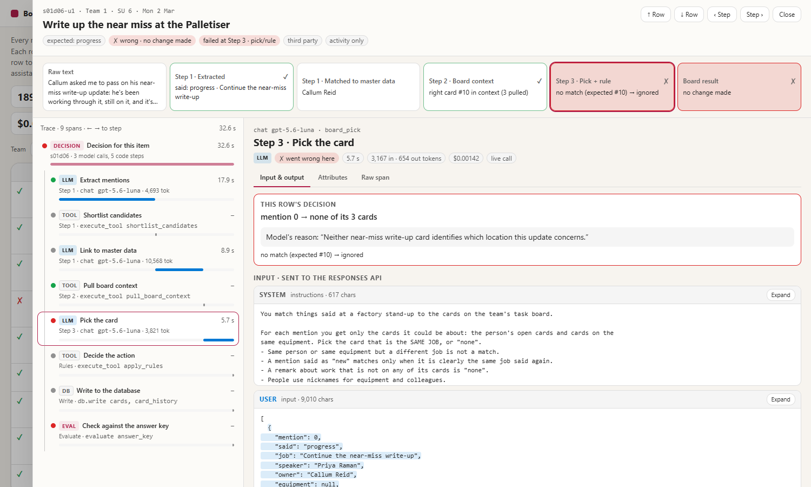

# What we learned

  

**The problem.** People talk through their jobs at the morning stand-up. We want those jobs on a task board, with
the right person and the right machine. And the next day, when someone says "that's done", the board should update
itself.

This is a POC on made-up data. Below is what we'd tell anyone starting on the same problem.

## The short version

1. **Use two small model calls, not one big one.** First pull out what people said, in their own words. Then match
   those words to your people and machines. 8 of the 10 models we tried did better this way.
2. **You don't need a big model.** GPT-5.6 Luna for both steps got 72% of jobs fully right for half a cent a
   meeting. GPT-5.4 got 71% for ten times the price.
3. **Nicknames are the hard part.** "The Atlas." "The cold unit." Machines called by a name in your master data were
   linked right every time; nicknames the model had never seen, 74%. So add the nicknames people really use. And
   don't give the model your whole asset list: give it a short list of likely matches and let it pick.
4. **Make the answer key first, then the meeting.** Then you can score every step, with no labelling.
5. **Load the board in code. You don't need an agent.** For each thing said, pull that person's open cards and
   anything on the same machine. That's about 4 cards, and the right one was in there every time. Then the model
   only has to pick.
6. **Let the model pick. Let rules do the writing.** An update never creates a card, so a stray remark can't make a
   junk card.
7. **Ask the model why.** One short sentence, written before its answer. It's cheap, and every decision explains
   itself.
8. **Score every step, and look at the traces.** That's how we found the real problems and fixed them.

## 1. Picking a model

We tried 163 ways of turning a transcript into jobs and scored them on 20 meetings with 133 jobs (±8 points).

|  | Extract → match | Every field right | Cost a meeting |
| --- | --- | --- | --- |
| Best | GPT-5.6 Luna → GPT-5.6 Luna | 72% | $0.0047 |
| Close behind | GPT-5.4 → GPT-5.4 | 71% | $0.045 |
| Cheapest good | GPT-6 Luna → GPT-6 Luna | 68% | $0.0024 |
| No model at all | regex rules → text classifier | 47% | $0 |

- Local models (GLiNER), even fine-tuned on our data, didn't beat plain regex rules end to end.
- On nicknames nobody had seen before, LLM matchers got 59–80% right. Embeddings alone got 31%, fuzzy matching 17%.

Everything is in [`RESULTS.md`](docs/01-extraction-experiment/RESULTS.md), and you can click through every
meeting, prompt and result in the [report](docs/02-walkthrough/v2-report/index.html).

## 2. Synthetic data with a free answer key

  

- A simulator decides what happens first: who owns what, which machine, when it's due, and what happens to each job
  over 8 days. That's the answer key.
- Then a model writes the Teams stand-up around it, with chit-chat and nicknames, and a check makes sure every job
  is really in the text.
- **Watch out for writer bias.** GPT-5.4 looked best on transcripts it wrote itself. On GPT-6 Astra's transcripts,
  that lead disappeared. Use a different model to write the data from the ones you're testing.

Your data will be different from ours. [**`DATA.md`**](DATA.md) explains the ontology (people, sites and machines
with their nicknames), how both datasets were made, and every change that moved the numbers, with before and after.

## 3. Keeping the board up to date

  

Every stand-up runs the same three steps:
1. **Extract** what was said (model): every job, new or update.
2. **Pull the cards** (code): that person's open cards, plus cards on the same machine.
3. **Pick** the matching card and say why (model). Then fixed rules create, update or ignore.

A JSON file stands in for the real database, with the same five tables we'd load into Power BI.

We scored it on 3 teams × 8 stand-ups (189 things to get right). Each stand-up starts from the board the pipeline
built the day before, so mistakes carry forward.

|  | Result |
| --- | --- |
| Updates exactly right | 97% (105 of 108) |
| Right card in the short list | 100%, about 4 cards each time |
| Cards closed by mistake | 1 of 52 |
| Duplicate cards | 0 |
| Stray "done" remarks ignored | 21 of 22 |
| New jobs with every field right | 67% |
| Cost and time | $0.0074 and about 26 s a stand-up |

**Where it still goes wrong:**
- **New jobs** are the weak spot. The misses are in the fields, mostly equipment (11) and priority (10).
- **Updates** missed 3 times. Twice someone said "the near-miss write-up" when there were two near-miss cards and
  nobody said which. The model said so itself: *"Neither near-miss write-up card identifies which location this
  update concerns."* The third used a machine nickname it had never seen ("the Arburg"), so it didn't link it to the
  right card.

## 4. Why we didn't build the agent

  

We designed an agent with Microsoft Agent Framework and six board tools (`get_board`, `find_equipment`,
`create_card`, `update_card`, `add_comment`, `cancel_card`). It would look at the board, then decide what to do.

When we stepped back, it didn't need to be an agent:
- Everything it would fetch with a tool, we already know before we call the model: who spoke, which machine, and
  their open cards. Plain code can load that.
- The decision itself is small: "is this the same job as one of these 4 cards?"
- An agent re-sends the whole conversation every turn (our design guessed 5–10× the tokens), can take a different
  path each run, and is harder to test one step at a time.

**When an agent would make sense:** when it can't know up front what it needs. Open questions, lots of systems to
look through, or needing to ask a person to clear something up.

The design is still there if you want it: [`docs/03-agent/DESIGN.md`](docs/03-agent/DESIGN.md).

## 5. See how every decision was made

  

The [dataset & trace explorer](docs/04-board-pipeline/trace-explorer/index.html) has one row for each thing the
pipeline should get right. Click a row to see its trace, laid out like a Foundry trace: the prompt, what the model
was given, what it sent back, its reason, and the code steps in between.

- **Reasoning summaries:** our deployment doesn't return them (we tried all three settings). So we ask for a
  one-line `reason` before the answer. It cost 0.02 of a cent a stand-up and got one more update right.
- **Per-step scores showed us the real fixes.** Using the matcher's top 3 name guesses, not just its first, took
  "right card in the short list" from 92% to 100%. Telling the model "a job first raised in this meeting is always
  new" stopped new jobs being ignored as updates.

## What we'd do next

- Try it on a handful of real (anonymised) stand-ups, to check the synthetic numbers hold up.
- Fix the new-job fields: a clearer priority rubric and more equipment nicknames in the master data.
- When two cards look the same, ask a person instead of guessing.
- Swap the JSON file for the real database. It's the same five tables.

## Caveats

- Made-up data from one made-up plant. Real meetings will be messier.
- Small test sets: 133 jobs (±8 points) for the model test and 24 stand-ups for the board.
- The model names and prices are our Foundry deployments at the time. Newer models may change the picture.

Want to use this for your own problem? See [`ADOPTING.md`](ADOPTING.md). Different data? Start with [`DATA.md`](DATA.md).
