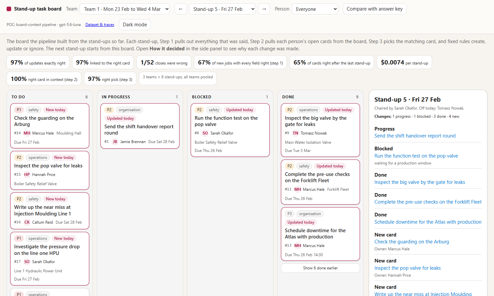

# Stand-up to task board: a POC, shared as learnings

<p align="center">
  
</p>

People talk through their jobs at the morning stand-up. This POC turns those Teams transcripts into cards on a
task board, with the right person and the right machine. Then it keeps the board up to date at every stand-up after
that: "that's done" closes the card, "still waiting on parts" blocks it, and a new job makes a new card.

It all runs locally, on made-up data. We're sharing it as a head start for anyone with the same problem: the model
tests, the synthetic data with its answer key, the pipeline, and a way to see how every decision was made.

## What we found

- **Two small model calls beat one big one:** pull out what was said, then match it to your people and machines.
- **You don't need a big model:** GPT-5.6 Luna for both steps got 72% of jobs fully right, for half a cent a meeting.
- **You don't need an agent:** code loads that person's cards from the board, about 4 of them, and the right one
  was in that list every time. The model only has to pick. 97% of updates came out exactly right, for $0.0074 a
  stand-up.
- **The weak spot is new jobs:** 67% get every field right. Machine nicknames and priority cause most misses.

The five-minute version, with the animations: **[`FINDINGS.md`](FINDINGS.md)**. Your data will be different, so
**[`DATA.md`](DATA.md)** explains our ontology (people, sites and machines with their nicknames), how we made the
data, and every change that moved the numbers.

## See it, no install

<p align="center">
  <a href="docs/04-board-pipeline/mock-board/index.html"></a>
  <a href="docs/04-board-pipeline/trace-explorer/index.html"></a>
</p>

| Open this | To see |
|---|---|
| [`mock-board/index.html`](docs/04-board-pipeline/mock-board/index.html) | The board after each of 24 stand-ups, and how each change was decided |
| [`trace-explorer/index.html`](docs/04-board-pipeline/trace-explorer/index.html) | Every decision, right or wrong, with its full trace: prompt, input, output and the model's reason |
| [`v2-report/index.html`](docs/02-walkthrough/v2-report/index.html) | The model experiment: which method won, and every meeting, prompt and result |

They're single HTML files: download the repo and double-click. The live demo, where you watch a stand-up run step
by step, needs a quick install.

## Use it

**[`ADOPTING.md`](ADOPTING.md)** covers:
- installing in about 5 minutes;
- pointing it at your own models;
- swapping in your own people and machines;
- lifting just the pieces you need, like the step that pulls cards from the board, the JSON stand-in database,
  the scorer and the trace page.

## What's in here

We tried four approaches, in this order:

| # | Approach | What happened | Read |
|---|---|---|---|
| 1 | **Pick a model** | 163 ways tried. GPT-5.6 Luna for both steps won on quality and cost. | [`docs/01-extraction-experiment`](docs/01-extraction-experiment/README.md) |
| 2 | **Show the working** | A click-through report and a slide deck of the experiment | [`docs/02-walkthrough`](docs/02-walkthrough/README.md) |
| 3 | **Agent** | Designed, then parked: code can load the board, so it doesn't need to be an agent | [`docs/03-agent/DESIGN.md`](docs/03-agent/DESIGN.md) |
| 4 | **Board pipeline** | Built: extract, pull the cards, pick, and rules write it. Has a live demo and trace explorer. | [`docs/04-board-pipeline`](docs/04-board-pipeline/README.md) |

## Where things live

```
FINDINGS.md               what we learned (start here)
DATA.md                   the ontology, how we made the data, and what made results better
ADOPTING.md               how to use it for your own problem
data/ontology.yaml        your world: people, sites, machines (with nicknames), categories, priority rubric
data/models.yaml          model catalogue: deployment, endpoint, API style, price
data/meetings*/           synthetic meetings for the model experiment (.json answer key + .vtt transcript)
data/series/              synthetic stand-up series for the board: 3 teams x 8 days
src/standup_exp/
  board/                  the board pipeline: context.py (pull the cards), context_pipeline.py (extract, pick,
                          rules), store.py (JSON database), evaluate.py, explorer.py, demo.py, simulate.py
  llm.py                  model client: strict JSON schema, reply cache, cost, trace_calls()
  generate/ extractors/ normalisers/ runner.py evaluate.py report.py    the model experiment
docs/
  findings/               the animations and screenshots used in FINDINGS.md
  01-extraction-experiment/   the model experiment: README and RESULTS.md
  02-walkthrough/         v2-report/ and v1-deck/: the experiment as click-through pages
  03-agent/               the agent design we parked
  04-board-pipeline/      README, DESIGN, mock-board/, trace-explorer/, live-demo/
results/                  latest scores; board/ holds the board runs, traces and JSON databases
tests/                    offline tests: pytest -q
```

Synthetic data only. No real people, plants or transcripts.
