# Approach 1 · Extraction experiment

<p align="center">
  
</p>

**Question:** given a morning stand-up transcript, which method turns it into dashboard-ready jobs best, and at
what cost and speed?

We generate synthetic Microsoft Teams stand-ups for a made-up plastics plant (engineers, jargon, nicknames,
chit-chat, blockers, jobs with owners, equipment, sites, deadlines and urgency), then score every extractor ×
matcher combination against the answer key each transcript was written from.

- [`RESULTS.md`](RESULTS.md): the full scoreboard for both test sets, rebuilt by `standup-exp report`.
- To click through every meeting, prompt and result, open the [approach 2 report](../02-walkthrough/v2-report/index.html).

## Headline results

**Latest results: [RESULTS.md](RESULTS.md)** · walkthrough report: [`v2-report`](../02-walkthrough/v2-report/index.html).
Main test set: 20 meetings written by GPT-6 Astra, 133 real jobs (±8 points at 95%); 163 pipelines.

| | Pipeline (extract → match) | Dashboard-ready | $/meeting | s/meeting |
|---|---|---|---|---|
| Best quality (top 5 tied within ±8) | GPT-5.6 Luna → GPT-5.6 Luna picks from a shortlist | 72% | $0.0047 | 17 |
| | GPT-5.4 → GPT-5.4 · Mistral Large 3 → Mistral Large 3 | 71% | $0.045 · $0.008 | 12 · 23 |
| Cheapest good | GPT-6 Luna → GPT-6 Luna | 68% | $0.0024 | 16 |
| No LLM | Regex rules → trained text classifier | 47% | $0 | 0.1 |

- **Two steps beat one call** for 8 of the 10 models that ran reliably (GPT-6 Sol tied, GPT-6 Astra did better in one call).
- **The writer check matters.** On its own transcripts GPT-5.4 led clearly (66% vs 60% for the next best, 53 jobs). On GPT-6 Astra's transcripts that lead disappears: GPT-5.4 71% vs GPT-5.6 Luna 72%.
- **Unseen nicknames are still the hard part:** given the correct words, LLM matchers link 59–80% of never-seen equipment nicknames. OpenAI text-embedding-3-large gets 31% (MiniLM 11%), fuzzy 17%.
- **GLiNER 2.5 base:** more training data helped the fine-tune (12 → 112 meetings: precision 79% → 87%, recall 38% → 50%). Every GLiNER variant still trails plain regex rules end to end. GLiNER2.5-Decide finds more jobs, but it is poor at choosing names (7% on held-out nicknames).
- **Grok 4.6** timed out on 10 of 20 meetings even with a 600 s limit.

## What you get

- **Synthetic data with a true answer key, from two writers.** Jobs are sampled first, then an LLM
  writes the meeting around them and a validator checks every job is really in the transcript.
  `data/meetings` has 20 meetings written by **GPT-5.4** (12 train / 8 test, 53 test jobs). `data/meetings-astra` has 120 meetings written by
  **GPT-6 Astra** (100 train / 20 test, 133 test jobs; ids `a000`–`a119`).
  Every meeting stores its writer (`models.yaml` id). Scoring both sets checks whether a model does better
  on transcripts written by itself. Test meetings use equipment nicknames no matcher has seen.
- **Extractors** (transcript → raw jobs, in the words people used):
  `rules` (regex), `gliner` (GLiNER 2.5 base, zero-shot), `gliner_decide` (fastino/GLiNER2.5-Decide, a GLiNER 2.5 classification checkpoint, zero-shot),
  `gliner_ft` / `gliner_ft_all` (GLiNER 2.5 base fine-tuned on 12 / all 112 training meetings),
  `llm@<model>` (strict JSON schema), and `llm_direct@<model>` (extracts and links to IDs in one call).
- **Matchers** (raw words → business IDs, categories and priorities):
  `alias`, `fuzzy` (rapidfuzz), `embedding` (MiniLM, local), `embedding_oai` (OpenAI
  text-embedding-3-large),
  `classifier` (TF-IDF + logistic regression), `gliner`, `gliner_decide` and `llm@<model>`.
  Both embedding matchers calibrate acceptance thresholds from known aliases only (leave-one-alias-out,
  5th percentile), never from test data. The GLiNER and LLM matchers choose from a fuzzy + OpenAI
  embedding shortlist (set `SHORTLIST_EMBED=minilm` to use MiniLM instead), so they never see the whole asset register.
- **11 Foundry models** from [`data/models.yaml`](../../data/models.yaml): GPT-6 Astra/Sol/Luna,
  GPT-5.6 Sol/Terra/Luna, GPT-5.4, GPT-5.4 mini, GPT-5.2, Grok 4.6 and Mistral Large 3.
  They sit on two Foundry resources (set in `.env`). Grok gets a longer timeout (see `models.yaml`; others 240 s), and a
  timeout scores as “found nothing”.
- **One scoreboard per test set**: quality with a 95% margin of error, cost per meeting and latency per
  meeting, plus a matching-only stage that feeds the correct words straight into each matcher.
- **A walkthrough deck** ([`v1-deck`](../02-walkthrough/v1-deck/index.html)): a self-contained
  19-slide HTML file. Each slide states its scope (whole experiment, one test set or one meeting) and has
  its own pickers. It shows every meeting, the exact prompts and schemas each LLM received, what each
  extractor returned, the shortlist each matcher chose from, and the outcome, cost and latency.

## Run locally

Requires Python 3.12 and [uv](https://docs.astral.sh/uv/) (plain `pip` works too). Run everything from the repo root.
This installs the full stack, including the local GLiNER and embedding models; for the board pipeline alone, see
[`ADOPTING.md`](../../ADOPTING.md).

```powershell
uv venv --python 3.12 .venv
uv pip install --python .venv\Scripts\python.exe -e ".[local,train,dev]"
.venv\Scripts\Activate.ps1

standup-exp demo          # offline: template transcripts + rules/alias/fuzzy/classifier
pytest -q                 # offline tests
```

The full experiment needs Foundry access. Copy `.env.example` to `.env` and fill in the endpoints, then change each
`deployment` in [`data/models.yaml`](../../data/models.yaml) to your own deployment names.
Keys are optional; `az login` (Entra ID) is used when a key is empty.

```powershell
# data: 20 GPT-5.4 meetings (12 train / 8 test) and 120 GPT-6 Astra meetings (100 train / 20 test)
standup-exp generate --n 20
standup-exp generate --writer gpt-6-astra --prefix a --seed 11 --n 120 --test-fraction 0.1667 --workers 4 --out data\meetings-astra
standup-exp show a104 --data data\meetings-astra      # read a transcript and its answer key

standup-exp finetune --epochs 1 --eval-steps 90 --out-name gliner-standup-all --negatives 2
standup-exp run --models all --data data\meetings-astra --merge   # every permitted extractor x matcher on one test set
standup-exp run --models all --data data\meetings
standup-exp report                                    # RESULTS.md (this folder)
standup-exp walkthrough --reuse                       # re-render ../02-walkthrough/v1-deck/index.html; never calls a model
```

Useful v2 switches: `generate --writer --prefix --extra-train --workers`, `finetune --data --epochs --eval-steps --out-name --negatives`, `run --cache-only --merge`, and `walkthrough --reuse`.

`--models all` expands `llm` / `llm_direct` / the `llm` matcher into one method per model. An LLM extractor is
paired with local matchers and only that same model's LLM matcher, so each row's LLM cost belongs to one model.
The CPU-heavy GLiNER matchers are paired only with local extractors, and `llm_direct@<model>` is paired only
with `passthrough`; the matching-only stage still scores every matcher on every gold mention. Every LLM reply, embedding, extraction and GLiNER match is cached under `results/cache/`,
so re-scoring is free. `--cache-only` guarantees no paid call is made.

## How it is scored

| Metric | Meaning |
|---|---|
| **Dashboard-ready** | Share of gold jobs found with *every* field right: owner, component, site, due date, priority and category. The headline number. |
| Task F1 | Did it find the right jobs? Predicted jobs are matched to gold by evidence overlap, summary similarity, component and owner (Hungarian matching). |
| Field accuracy | Per field, over matched jobs; a correct null counts as correct. |
| Held-out | Accuracy on mentions that use a nickname absent from the vocabulary, e.g. "the cold unit" for the Line 3 chiller. |
| ± | 95% margin of error for the test set's size (normal approximation); smaller differences are ties. |
| $/meeting | Tokens × list price in `data/models.yaml`. Local models are $0. |
| s/meeting | Summed API or CPU time per meeting, recorded even when replayed from cache. |

## Design choices

- **Extract and link separately.** Extractors copy what people said and
  normalisers map it to master data, so each can be swapped and measured on its
  own. `llm_direct` is the one-call baseline that checks whether the split pays off.
- **Guard against writer bias.** GPT-5.4 wrote the original test set and also topped early
  leaderboards, so v2 adds a larger GPT-6 Astra-written set and reports results per set
  plus a writer comparison.
- **Report uncertainty.** Dashboard-ready is a proportion over a finite number of jobs,
  so tables include 95% margins of error; differences inside the margin are ties.
- **Calibrate without test data.** Embedding thresholds are learned by leave-one-alias-out
  on the known vocabulary only. Shortlists for LLM/GLiNER matchers combine rapidfuzz with
  OpenAI text-embedding-3-large by default (`SHORTLIST_EMBED=minilm` restores MiniLM).
- **Keep the matrix honest.** CPU-heavy GLiNER matchers run only with local extractors,
  LLM extractors use local matchers or their own model's LLM matcher, and one-call LLMs use
  only `passthrough`; failures are scored as “found nothing”.
- **Business rules live in data, mostly.** Categories, priorities (no urgency stated → 2)
  and the asset hierarchy come from [`data/ontology.yaml`](../../data/ontology.yaml) and
  go verbatim into every LLM prompt. The three category names and the 1–3 priority scale are also fixed in the
  output schemas, so keep them or change both.
- **Dates are resolved in code** by [`dates.py`](../../src/standup_exp/dates.py). The
  generator and every normaliser use the same convention.
- **Unsure? Say the parent.** When two sibling assets tie, the normalisers return
  the parent asset. Scoring gives half credit for the parent.
- **No gold leaks.** Extractors only see a `TranscriptView`. Held-out nicknames
  appear only in test meetings and never in any vocabulary or training data.
