# POC: a stand-up agent that keeps a task board up to date

> **We designed this, then parked it.** When we stepped back, everything the agent would fetch with a tool (who
> spoke, which machine, their open cards) is known before the model is called, so plain code can load it. The
> decision left is small: "is this the same job as one of these ~4 cards?" So we built the
> [board pipeline](../04-board-pipeline/README.md) instead: 97% of updates exactly right, three model calls and
> $0.0074 a stand-up. The design below is kept for anyone whose problem really does need an agent: open-ended
> questions, lots of systems to search, or asking a person for help. The short version, with the animation, is
> section 4 of [`FINDINGS.md`](../../FINDINGS.md).

<p align="center">
  
</p>

| | |
|---|---|
| **Status** | Design only, **parked**. The pipeline with board context was built instead: [`docs/04-board-pipeline/DESIGN.md`](../04-board-pipeline/DESIGN.md). |
| **Runs** | Locally only (`localhost`). Nothing is deployed. The only cloud calls are to the existing Foundry model deployment. |
| **Data** | Synthetic stand-ups we generate ourselves. The existing `data/series` set is reused as-is. |
| **Model** | GPT-5.6 Luna (`receipt-gpt-56-luna`), the same deployment as the board pipeline |
| **Framework** | Microsoft Agent Framework (MAF) for Python 1.19 (`agent-framework-core` + `agent-framework-openai`) |
| **Principle** | Simplicity first. It is a demo and a measurement, not a product. |

---

## 1. In one paragraph

A MAF agent is given a stand-up transcript and six tools. It calls `get_board()` to see what already exists,
then works through the transcript in order:
- it updates cards that exist (done, progress, blocked, reassigned, new due date, comment, cancel);
- it looks up equipment and creates cards for genuinely new jobs;
- it ignores chit-chat.

The tools write to a small in-memory board store, and every change is pushed live to a browser page, so you
watch cards appear and move as the agent works. The board is the agent's only memory: the next stand-up
starts from whatever it built. The same agent and tools also run headless over all 24 synthetic stand-ups
and are scored with the scorer we already have, so the demo comes with numbers against the fixed pipeline.

## 2. How we got here

1. **Extraction experiment:** the repo's main question. Which method turns a transcript into
   dashboard-ready jobs? The best practical choice is GPT-5.6 Luna extracting → GPT-5.6 Luna matching.
2. **Board track (built, v0):** a fixed loop:
   - step 1 adds new jobs;
   - step 2, one "update check" call, updates the open cards;
   - code applies the result, and the next stand-up starts from that board.

   The animation in `docs/04-board-pipeline/board-loop.svg` now shows the newer context-pipeline design, not v0.

   On 3 teams × 8 stand-ups:

   | | Result |
   |---|---|
   | Updates exactly right | 96% |
   | Updates linked to the right card | 98% |
   | Wrong closes | 0 of 52 |
   | Cost | $0.005 per stand-up |

   New-job fields are the weak spot: 67% have every field right. A mock board lives at `docs/04-board-pipeline/mock-board/index.html`.
3. **The idea:** make it agentic. A MAF agent calls for the board's status, so it knows what exists, and
   decides for itself whether to create, update or cancel a task.
4. **This document:** that idea as a local POC demo, with a researched answer to "how do the tools change the UI?"

## 3. Goals and non-goals

**The POC must show:**
1. **The live demo:** a browser board that fills and updates as the agent's tool calls happen, one stand-up
   at a time, with every change traceable to a transcript quote.
2. **That the agent can tell whether a task exists:** it updates existing cards rather than duplicating them,
   and creates cards only for new jobs.
3. **Numbers:** the same scores as the board pipeline on the same 24 stand-ups, plus tool calls, cost and
   run-to-run spread.

**Not in scope:**
- deployment, authentication beyond `az login`, multiple users;
- approval flows, multiple agents, chat with the agent;
- a real task system (Planner, Azure DevOps, Jira);
- new data generation methods;
- other models (unless Luna can't handle the tool loop; see §12).

## 4. What the demo looks like

```powershell
uv pip install -e ".[agent]"
standup-exp agent demo            # starts http://localhost:8765 and opens the browser
```

1. Pick **Team 1**. The board is empty, and the transcript for stand-up 1 is shown.
2. Click **Run stand-up 1**. The agent's tool calls stream into a log panel (`get_board()` →
   `find_equipment("the spinner")` → `create_card(...)` …), and each new card appears on the board as it is created.
3. Click **Run stand-up 2**. The agent reads yesterday's board, and cards move to Done, In progress or Blocked,
   each with a note. One new card appears, and a remark with no card produces no call. This is the animation above, live.
4. Toggle **Compare with answer key**. As in the existing board UI, each card is marked right or wrong, and missed
   updates and wrong closes are shown.
5. Carry on through all 8 stand-ups, or click **Run all** and watch the week play out.

A **pace** setting (default 0.6 s per tool call) slows the agent down enough to follow. It only adds a
delay before each call; the results are unchanged.

## 5. Architecture

Everything runs in one local Python process:

```
                       ┌──────────────────────── standup-exp agent demo (one process) ────────────────────────┐
 browser               │                                                                                        │
 localhost:8765        │   FastAPI app                                                                          │
 ┌──────────────┐      │   ┌────────────┐   run stand-up    ┌───────────────────┐   tool calls   ┌───────────┐  │
 │ board page   │ POST │   │ /api/run   │ ────────────────▶ │ MAF Agent         │ ─────────────▶ │ 6 tools   │  │
 │ (HTML + JS)  │ ───────▶ │            │                   │ GPT-5.6 Luna      │ ◀───────────── │ (Python)  │  │
 │              │      │   └────────────┘                   │ fresh session     │   "ok: …" /    └─────┬─────┘  │
 │              │      │                                    │ per stand-up      │   "error: …"         │        │
 │              │ SSE  │   ┌────────────┐   publish         └───────────────────┘                ┌─────▼─────┐  │
 │ EventSource  │ ◀─────── │ /api/events│ ◀─────────────────────────────────────────────────────── │ BoardStore│  │
 └──────────────┘      │   └────────────┘   card / tool / status / score events                  │ in memory │  │
                       │                                                                           └───────────┘  │
                       └──────────────────────────────────────────────────────────────────────────────────────────┘
                                                        │ only external call: Foundry model (az login)
```

### 5.1 How tool calls change the UI (the part we researched)

**Rule: the tools are the only writers, and the page is only a viewer.** The browser never talks to the
agent. It shows the `BoardStore` and hears about every change.

What happens on each tool call:
1. The agent calls a tool, for example `update_card("c3", "blocked", note, quote)`.
2. The tool checks the call against the store:
   - card `c3` exists and is open;
   - the change is allowed;
   - the quote is present.
3. **If the call is valid:**
   - the store applies it using the board track's `BoardEvent` + `apply`;
   - it publishes a `card` event with the updated card;
   - the tool returns `ok: c3 is now blocked`.
4. **If the call is invalid:** the tool returns `error: c9 does not exist; call get_board()`. Nothing changes, and the
   agent can correct itself.
5. A small MAF **function middleware** also publishes a `tool` event for *every* call (name, arguments, duration
   and whether it was accepted), which feeds the log panel. Where the demo pace is set, the delay is added here.
6. The page receives the events over **Server-Sent Events** (SSE):
   - a `card` event redraws that card in its new column and flashes it;
   - a `tool` event appends a line to the log.

This keeps three things independent: the agent (reasoning), the tools and store (the rules and the state), and
the page (display). The same store and tools run without a server for batch scoring.

Events on the wire (`/api/events`, `text/event-stream`):

| Event | Payload | Page does |
|---|---|---|
| `board` | the full board, sent first when a page connects or after a reset | draws everything |
| `card` | one card after it was created or changed, plus the change kind and quote | moves or redraws that card and flashes it |
| `tool` | `{name, args, accepted, message, ms}` | appends to the tool-call log |
| `status` | `running` / `done` / `error` for a stand-up, plus a one-line summary | enables and disables buttons, shows the summary |
| `score` | that stand-up's scores against the answer key (reuses `board.evaluate.score_day`) | powers **Compare with answer key** |

### 5.2 Options we considered for the UI link

| Option | What it is | Verdict |
|---|---|---|
| **Our own SSE stream from the store** | FastAPI endpoint streaming store events to `EventSource` in the page | **Chosen.** One-way server → browser is all we need. No client library, about 40 lines, runs locally. |
| Poll a JSON file | Tools write `board.json`, the page re-reads it every second | Simpler still, but it loses the order of changes (no live tool log) and still needs a local server. |
| MAF **DevUI** (`agent-framework-devui`, beta) | Generic local web UI: chat, tool calls, traces | Good for debugging the agent, but it doesn't show *our* board. Optional side tool, not the demo. |
| MAF **AG-UI** (`agent-framework-ag-ui` 1.4) | Standard protocol: the agent as an HTTP endpoint streaming text, tool-call and state events over SSE, often with CopilotKit (React) | The right answer for a real app with many clients, approvals and shared state. For a local single-user POC it adds a protocol and a React client we don't need. **The upgrade path, not the POC.** |

## 6. The agent

**Client.** MAF's `OpenAIChatClient` (Responses API), pointed at the existing endpoint:

```python
from agent_framework import Agent
from agent_framework.openai import OpenAIChatClient
from azure.identity import AzureCliCredential

client = OpenAIChatClient(
    base_url=env("BENCH_OPENAI_ENDPOINT"),     # the existing …/openai/v1/ URL from .env
    model="receipt-gpt-56-luna",               # deployment name
    credential=AzureCliCredential(),           # az login, as the rest of the repo
)
agent = Agent(
    client=client,
    name="board_keeper",
    instructions=INSTRUCTIONS,
    tools=make_tools(store),                   # six functions bound to this run's BoardStore
    middleware=[ToolLog(store, pace=0.6)],     # publishes `tool` events, adds the demo pace, enforces the cap
)
result = await agent.run(stand_up_message)     # one run per stand-up
```

**One fresh session per stand-up.** The agent's memory between days is the board, which it reads with
`get_board()`, not chat history. That is the point of the design, and it keeps each stand-up's context small.

**Instructions:**
- the existing job rules from `extractors/llm.py` (what counts as a new job, and what doesn't: finished work,
  observations, chit-chat);
- the business rubric (category and priority);
- how to work:
  1. call `get_board()` first;
  2. go through the transcript in order;
  3. for each job or update, decide whether it's an existing card (update it) or new (look up the equipment,
     then create it);
  4. never create a card for something already on the board;
  5. only close or cancel a card when the meeting clearly says so;
  6. end with a one-line summary.

**The stand-up message:**
- the meeting date;
- the team roster (ids, names, known nicknames, who is present);
- the five sites (small, so they go in the prompt);
- the transcript.

The asset register is **not** in the prompt; equipment is looked up with `find_equipment`, because real registers
are large.

**Guard rails:**
- **Tool-call cap:** 40 per stand-up, enforced in the middleware; after that every tool returns an error.
- **Retries on model errors:** if a stand-up fails (API error or cap hit), the board keeps what was applied, the day
  is marked failed, and the next day continues.

## 7. The tools

Tools are plain Python functions with `Annotated[..., Field(description=...)]` parameters, which MAF turns into
the tool schema. `make_tools(store)` binds them to the run's `BoardStore`. Every tool returns a short string
starting with `ok:` or `error:`, which the agent can read.

| Tool | Arguments | Store effect | UI effect |
|---|---|---|---|
| `get_board()` | none | none | log line |
| `find_equipment(words)` | the words people used | none; returns the top 5 `{id, name, parent}` from the existing fuzzy + embedding shortlist | log line |
| `create_card(summary, owner_id, component_id, site_id, due_words, priority, category, quote)` | ids from the roster, sites or `find_equipment` | new card `c<n>` in To do | card appears (flash "New") |
| `update_card(card_id, change, note, quote, new_owner_id?, due_words?)` | `change` ∈ progress, blocked, done, reassigned, due_changed | status, owner or due date changes, and the note goes on the history | card moves or redraws (flash "Updated") |
| `add_comment(card_id, note, quote)` | none extra | history only | comment count changes |
| `cancel_card(card_id, reason, quote)` | none extra | status cancelled; nothing is deleted | card moves to Done, struck through |

**Validation, all returned as `error:` text:**
- unknown or closed card;
- unknown person, site or asset id;
- a missing quote;
- `reassigned` without an owner;
- `due_changed` or `due_words` that `dates.resolve_date` can't resolve.

**Other rules:**
- **Short card ids** (`c1`, `c2` …) are used so the agent can refer to them easily.
- **No hard delete.** Cancel keeps the audit trail, and the scorer already treats cancelled as a status.

A sketch of one tool:

```python
from typing import Annotated, Literal
from pydantic import Field

def make_tools(store: "BoardStore"):
    def update_card(
        card_id: Annotated[str, Field(description="Id of an open card from get_board(), e.g. 'c3'.")],
        change: Annotated[Literal["progress", "blocked", "done", "reassigned", "due_changed"],
                          Field(description="What happened to the job.")],
        note: Annotated[str, Field(description="One short sentence for the card's history.")],
        quote: Annotated[str, Field(description="The transcript sentence this comes from, copied exactly.")],
        new_owner_id: Annotated[str | None, Field(description="reassigned only: person id from the roster.")] = None,
        due_words: Annotated[str | None, Field(description="due_changed only: the new deadline as spoken.")] = None,
    ) -> str:
        """Change an existing card. Returns 'ok: …' or 'error: …'."""
        return store.update(card_id, change, note, quote, new_owner_id, due_words)
    # get_board, find_equipment, create_card, add_comment and cancel_card follow the same pattern
    return [get_board, find_equipment, create_card, update_card, add_comment, cancel_card]
```

## 8. BoardStore: the single source of truth

A small class of about 150 lines in `agent/store.py` that holds one series' board:
- **`cards`:** the current cards, as the board track's `Card` model.
- **`events`:** every accepted change, as a `BoardEvent`, per stand-up.
- **Methods:** `create(...)`, `update(...)`, `comment(...)` and `cancel(...)`. Each one validates the call, builds a
  `BoardEvent`, calls the existing `apply`, publishes a `card` event and returns the `ok:` / `error:` text.
- **`publish(kind, payload)`:** puts the event on an `asyncio.Queue` for each connected page. With no page
  connected, as in batch mode, it does nothing.
- **Recording and resetting:**
  - `snapshot(day_id)` records the board after each stand-up for replay and scoring;
  - `reset()` starts the series again.

Because the store reuses `BoardEvent` + `apply`, a finished stand-up converts directly into the board track's
`DayRun` (`create_card` calls become the day's new jobs), and `board.evaluate.score_day` scores it unchanged.

## 9. Data

- **Reuse `data/series` as-is:** 3 teams × 8 consecutive stand-ups, 81 new jobs, 108 updates, each with an answer key.
  - The data was generated by the board track: a simulator plans each card's fate first, then GPT-6 Astra writes the
    meeting, and a validator checks every job and update is actually said.
  - The hard cases are tagged: updates for someone else or an absent colleague, two jobs on the same equipment,
    activity-only references, unseen nicknames, and "done" remarks with no card.
- **More data if needed:** `standup-exp board generate --series N --days D --writer gpt-6-astra` (about $0.13 per stand-up).
- **The agent never sees the answer key.** It gets only what a real system would: the transcript, the date, the roster
  and the board it built.

## 10. How it is measured

**Batch run (no browser):**

```powershell
standup-exp agent run --model gpt-5.6-luna --repeats 3     # all 24 stand-ups, chained, three times
standup-exp board ui --results agent                        # the existing static board report, showing the agent's run
```

The same `score_series` as the pipeline produces a side-by-side table:

| Metric | Pipeline (GPT-5.6 Luna) | Agent (GPT-5.6 Luna) |
|---|---|---|
| Updates exactly right | 96% | ? |
| Updates linked to the right card | 98% | ? |
| Wrong closes | 0 of 52 | ? |
| Duplicate cards | 0 | ? |
| New jobs with every field right | 67% | ? |
| Cards fully right after the last stand-up | 63% | ? |
| Cost per stand-up | $0.0053 | ? |

**Agent-only measures:**
- tool calls and rejected calls per stand-up;
- days that hit the cap;
- tokens, seconds and $ per stand-up;
- **run-to-run spread:** the range across the 3 repeats.

**Breakdown by hard-case tag,** especially two jobs on the same equipment and activity-only references (the
pipeline's weakest, both at 90%).

**The POC succeeds if:**
1. the live demo runs end to end on the 24 stand-ups;
2. the agent is not clearly worse than the pipeline on updates and wrong closes (with 108 updates, the margin of
   error is about ±4 points);
3. it costs cents per stand-up.

It is a clear *win* if it improves the two weak tags or matches the pipeline with fewer moving parts.

## 11. Build plan

Each milestone ends with something checkable.

| # | Milestone | Done when |
|---|---|---|
| M0 | **Smoke test:** MAF + `OpenAIChatClient` on `receipt-gpt-56-luna` with one dummy tool | The model calls the tool and uses the result. Also confirm the `base_url` / `api_version` combination and where MAF reports token usage. |
| M1 | `BoardStore` + six tools, with **offline tests** (no model) | Every validation path covered; a store driven by the answer key scores 100% with the existing scorer |
| M2 | Agent on **one stand-up** in the terminal | Tool calls logged and the board printed for `s02d05` |
| M3 | **Batch runner** + scoring for all 24 stand-ups × 3 repeats | Results in `results/agent/`; the comparison table filled in |
| M4 | **Local server + live page** (FastAPI, SSE, board page) | The demo in §4 works, with no console errors, checked with the existing headless-browser pass |
| M5 | Polish: pace control, **Run all**, the compare overlay | A 3-minute walkthrough can be recorded |

**Cost to run:** Luna is cheap. A tool loop re-sends its context on every turn, so expect maybe 5–10× the pipeline's
tokens, which is still a few cents per stand-up and a few dollars for all runs.

## 12. Risks

| Risk | Mitigation |
|---|---|
| Luna is weak at long tool loops (stops early, skips updates) | Show it in the scores. If needed, one GPT-6 Astra run to tell whether the design or the model is at fault |
| Duplicates instead of updates | `get_board()` first is in the instructions; duplicates are reported |
| Runaway loops or cost | 40-call cap in the middleware; $ reported per stand-up |
| Invented ids | Tools reject them with an error; rejected calls are counted |
| Demo too fast to follow | Pace setting in the middleware |
| MAF API differs from these sketches | M0 confirms the client, tools and middleware before anything else is built |
| Different results each run | 3 repeats, spread reported; the demo is presented as one run |

## 13. Layout and dependencies

```
src/standup_exp/agent/
  store.py        BoardStore: cards + events, validation, publish, snapshot (reuses board.schema)
  tools.py        make_tools(store): the six tools
  agent.py        client, instructions, stand-up message, ToolLog middleware, run_standup()
  runner.py       batch: 24 stand-ups × N repeats, chained, scored with board.evaluate
  server.py       FastAPI: page, /api/run, /api/events (SSE), /api/reset
  static/app.html the live board page (reuses the look of docs/04-board-pipeline/mock-board)
tests/test_agent.py        offline: store + tools + scoring (no model)
results/agent/latest-<model>.json   same shape as results/board, plus the tool-call log
```

**Optional extra in `pyproject.toml`:**

```toml
agent = ["agent-framework-core>=1.19,<2", "agent-framework-openai>=1.14,<2", "fastapi>=0.110", "uvicorn>=0.29"]
```

## 14. Decisions so far

| Decision | Choice | Why |
|---|---|---|
| How much the agent does itself | It reads the transcript itself, with board tools plus `find_equipment` backed by the existing matcher | A real agent test, while keeping the matcher's handling of unseen nicknames |
| Step 1 as a hint | No | Test the agent reading the transcript itself |
| Delete | No hard delete; `cancel_card` | Audit trail; cancelled is already a status |
| Memory | The board only; a fresh session per stand-up | "The board is the agent's memory"; small, predictable context |
| UI link | Tools → BoardStore → our own SSE → page | Simplest live link; AG-UI is the upgrade path |
| Model | GPT-5.6 Luna | Like for like with the pipeline |
| Hosting | Local only | It's a POC demo |
| Approval flows | Not in the POC | Measure raw behaviour; keep it simple |

## 15. Open questions

1. Should `get_board()` include cards closed at the last stand-up? It helps with "no, I meant the other one", but
   it adds noise. Proposed: **yes**.
2. Should the demo stream the agent's final summary text too, or only tool calls? Proposed: **summary only**,
   shown once the stand-up finishes.
3. Should batch mode default to 3 repeats? Is it worth one Astra run whatever happens, for contrast?
